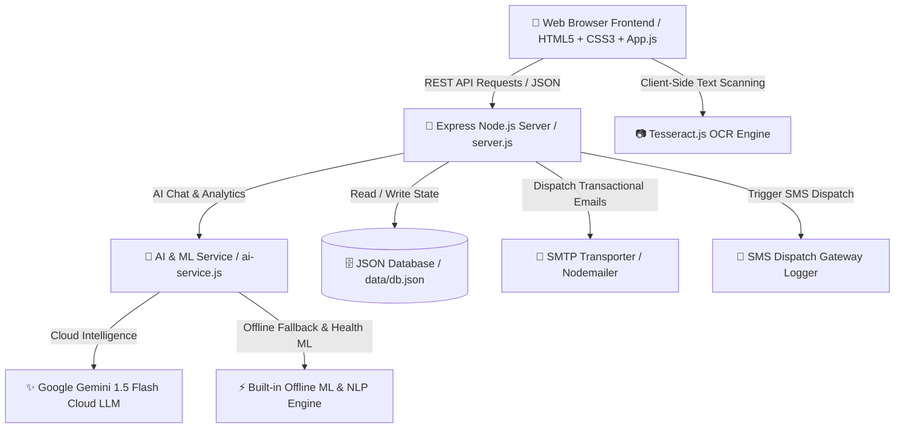
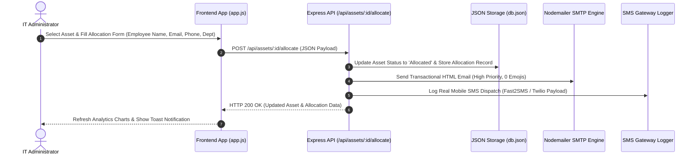
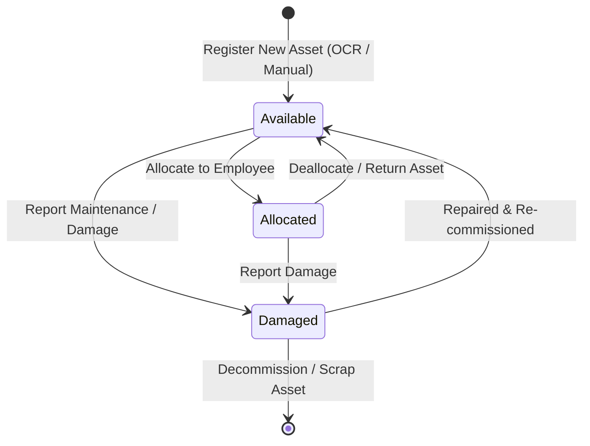
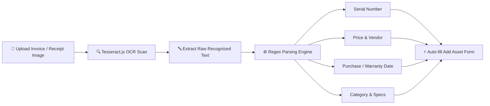

# 💻 Modern Enterprise IT Asset Management & Visual Analytics System

[](https://nodejs.org/)
[](https://expressjs.com/)
[](https://www.chartjs.org/)
[](https://vercel.com/)
[](LICENSE)

An enterprise-grade, lightweight, and high-performance **IT Asset Management & Hardware Lifecycle Tracking Platform** built with **Node.js, Express, HTML5, Modern CSS3 (Glassmorphism & Dual Dark/Light Themes), and Chart.js**.

Designed for IT Administrators, Ops Leads, and Asset Managers to track hardware inventory, manage employee device allocations, monitor warranty expiration risks, scan invoice specs via AI OCR, dispatch SMS & transactional emails, and visualize real-time cost analytics.

---

## 📸 System Overview & Key Features

| Feature | Description |
| :--- | :--- |
| 🤖 **AssetBot AI Assistant (Hybrid Mode)** | Floating conversational AI assistant powered by **Google Gemini 1.5 Flash** with automatic fallback to **Built-in Offline ML NLP Engine**. Answers natural language queries in English & Hindi/Hinglish! |
| 🔮 **Predictive Maintenance & Risk ML** | Machine learning multi-factor health degradation model calculating **Health Score (0-100%)**, **Failure Probability %**, **Remaining Useful Life (months)**, and preventive maintenance actions. |
| 🚨 **Hardware Damage & AI Diagnostics** | 1-Click damage reporting with instant AI fault mechanism diagnosis, health recalibration, safety hazard alerts, and OEM repair cost estimates in ₹ INR. |
| 🎯 **Smart ML Allocation Recommender** | Hardware compatibility matching engine recommending ideal devices based on employee role, department affinity, computing specs, and equipment health. |
| 💰 **Depreciation & Valuation Forecaster** | **Double-Declining Balance (DDB)** & MACRS financial model forecasting current book value, salvage rate, and 3-year residual fleet valuation. |
| 📑 **AI Executive Briefing Generator** | 1-click automated executive briefing synthesizing fleet health index, capital risk, capex replacement alerts, and actionable recommendations. |
| 📊 **Visual Analytics Dashboard** | Real-time **Chart.js** Doughnut & Gradient Bar charts showing Category Distribution, Department Equipment Cost (in ₹ Lakhs/Thousands), and Asset Status Breakdown with custom center metrics. |
| ⚠️ **Warranty Expiry Alerts** | Automated system tracking assets with warranty expiring within 30 days (`⚠️ Xd left` / `🔴 Expired`), featuring a top high-priority alert banner and 1-click filter. |
| 📱 **Employee Phone & SMS Dispatch** | Mandatory phone tracking during allocation with real-time SMS dispatch logger (Fast2SMS / Twilio SMS gateway integration ready). |
| 📷 **AI Invoice OCR Specs Scanner** | Integrated **Tesseract.js OCR** scanner to automatically parse hardware serial numbers, price, vendor, warranty, MAC address, and specifications from uploaded invoice images. |
| 📧 **Primary Inbox HTML Email Engine** | Deliverability-optimized transactional HTML email notifications (0 emojis, light corporate layout, dual MIME plain text fallback, priority headers) with custom SMTP modal setup. |
| 🌓 **Dual Dark / Light Mode** | Modern glassmorphic theme engine with real-time Chart.js theme re-rendering and localStorage persistence. |
| 🔍 **Real-Time Search & Multi-Filters** | Search by asset name, serial number, vendor, location, or employee; filter by category, status, and warranty alerts instantly. |

---

## 📐 Architecture & Workflow Diagrams

### 1️⃣ System Architecture Diagram



---

### 2️⃣ Asset Allocation & Notification Sequence



---

### 3️⃣ Asset Lifecycle State Machine



---

### 4️⃣ AI Invoice OCR Specs Processing Flow



---

## 🗄️ REST API Endpoints Specification

| Method | Endpoint | Description |
| :--- | :--- | :--- |
| `GET` | `/api/stats` | Aggregated KPI fleet metrics (total assets, available, allocated, damaged, total inventory value in ₹, expiring warranty count). |
| `GET` | `/api/assets` | Query hardware assets with optional search query, category, status, and warranty alert filters. |
| `POST` | `/api/assets` | Registers a new enterprise hardware asset (supports manual or OCR auto-fill). |
| `PATCH` | `/api/assets/:id/status` | Updates asset operational status (`Available`, `Allocated`, `Damaged`, `Under Maintenance`). |
| `DELETE` | `/api/assets/:id` | Safely removes an asset record from inventory. |
| `POST` | `/api/assets/:id/allocate` | Allocates asset to employee with phone tracking, dispatches transactional HTML email & SMS alert. |
| `POST` | `/api/assets/:id/deallocate` | Returns allocated device back to available inventory. |
| `POST` | `/api/assets/:id/report-damage` | **🚨 AI Damage Diagnosis**: Logs damage report, evaluates root-cause fault mechanism, recalibrates health score (0-100%), assesses safety risks, and estimates repair cost. |
| `GET` | `/api/assets/:id/damage-history` | Retrieves logged damage incidents and historic AI diagnostic evaluations for an asset. |
| `GET` | `/api/assets/:id/diagnostics` | Single-asset ML predictive health breakdown, failure probability %, remaining useful life (months), and risk factors. |
| `POST` | `/api/ai/chat` | **🤖 AssetBot AI Assistant**: Hybrid conversational query processor (Google Gemini 1.5 Flash + offline ML engine) supporting English and Hindi/Hinglish. |
| `GET` | `/api/ai/predictive-health` | Fleet-wide predictive maintenance health scores, risk categorization, and high-risk equipment alerts. |
| `POST` | `/api/ai/recommend-asset` | **🎯 Smart ML Recommender**: Hardware compatibility matching based on employee role, department affinity, and device health. |
| `GET` | `/api/ai/depreciation` | **💰 Financial Valuation**: Double-Declining Balance (DDB) & Straight-Line 3-year depreciation forecaster. |
| `GET` | `/api/ai/executive-summary` | **📑 AI Executive Briefing**: Synthesizes fleet health index, capital risk, capex replacement alerts, and action recommendations. |
| `GET` | `/api/ai/config` | Checks whether Google Gemini Flash API is connected and returns masked status. |
| `POST` | `/api/ai/config` | Saves or updates Google Gemini API key securely in configuration. |
| `GET` | `/api/allocations` | Returns all active & historic device allocations joined with asset metadata. |
| `GET` | `/api/email-logs` | Returns recent transactional email dispatch audit logs. |
| `GET` | `/api/smtp-config` | Returns active SMTP email server configuration (passwords masked). |
| `POST` | `/api/smtp-config` | Updates custom SMTP server credentials (Gmail, Outlook, AWS SES). |
| `POST` | `/api/test-email` | Dispatches test transactional email to verify SMTP transporter. |

---

## 🗃️ Enterprise Database Schema (`data/db.json`)

```json
{
  "assets": [
    {
      "id": 1,
      "asset_name": "MacBook Pro 16\" M3 Max",
      "serial_number": "MBP16M3202601",
      "category": "Laptop",
      "status": "Allocated",
      "purchase_date": "2026-01-15",
      "price": 249999,
      "vendor": "Apple India Retail (BKC Mumbai)",
      "warranty_expiry": "2029-01-15",
      "location": "Mumbai HQ (BKC)",
      "health_score": 98,
      "condition": "Excellent",
      "notes": "64GB Unified Memory, 1TB NVMe SSD, Space Black."
    },
    {
      "id": 8,
      "asset_name": "Dell UltraSharp 32\" 4K PremierColor Monitor",
      "serial_number": "DELL32U202688",
      "category": "Monitor",
      "status": "Damaged",
      "purchase_date": "2026-03-20",
      "price": 78500,
      "vendor": "Dell Commercial Direct",
      "location": "Bengaluru Tech Park (Tower B)",
      "health_score": 52,
      "damage_history": [
        {
          "id": "INC-1791879595612",
          "reported_at": "2026-10-13T08:19:55.612Z",
          "issue_category": "Display / Screen",
          "severity": "High",
          "previous_health_score": 85,
          "new_health_score": 52,
          "failure_probability": 45,
          "risk_level": "MODERATE",
          "reported_by": "Amit Joshi (IT Helpdesk)",
          "ai_diagnosis": {
            "fault_mechanism": "High-impact physical shock caused stress cracks across display substrate. Ribbon interconnect or digitizer matrix shows electrical discontinuity.",
            "estimated_repair_cost": "₹1,500 - ₹3,500 (Inspection) / ₹18,000 (Panel)",
            "safety_hazard_detected": false
          }
        }
      ]
    }
  ],
  "allocations": [
    {
      "id": 104,
      "asset_id": 5,
      "employee_id": "IND-EMP-1021",
      "employee_name": "Aarav Sharma",
      "employee_email": "aarav.sharma@techcorp.in",
      "employee_phone": "+91 98201 45230",
      "employee_department": "Software Engineering",
      "allocated_date": "2026-10-05T00:00:00.000Z"
    }
  ],
  "email_logs": [
    {
      "id": 304,
      "asset_id": 5,
      "employee_name": "Aarav Sharma",
      "employee_email": "aarav.sharma@techcorp.in",
      "subject": "IT Asset Allocated: Lenovo ThinkPad T14 Gen 4 (LNVT14G4202605)",
      "status": "Sent (Real Email Delivered)",
      "sent_at": "2026-10-05T10:14:00.000Z"
    }
  ]
}
```

---

## 🇮🇳 Real Indian Enterprise Employee & Hardware Fleet

The database is pre-populated with realistic, enterprise-grade records representing modern Indian technology hubs:

| Employee Name | Employee ID | Department | Assigned Equipment | Location |
| :--- | :--- | :--- | :--- | :--- |
| **Tushar Mahapatra** | `IND-EMP-1001` | Computer Engineering | **Lenovo ThinkPad X1 Carbon Gen 11** + **Dell UltraSharp 27" 4K** | Bengaluru Tech Park |
| **Jitendra Prasad Mahapatra** | `IND-EMP-1002` | Production Operations | **Apple MacBook Pro 16" M3 Max** (64GB RAM) | Mumbai HQ (BKC) |
| **Aarav Sharma** | `IND-EMP-1021` | Software Engineering | **Lenovo ThinkPad T14 Gen 4** + **Logitech MX Master 3S** | Pune Cybercity |
| **Priya Patel** | `IND-EMP-1045` | Product Design | **LG UltraFine 27" 5K Display** | Ahmedabad Studio |
| **Vikram Malhotra** | `IND-EMP-1082` | DevOps & Cloud | **Dell Latitude 7440 Ultra** + **Keychron Q1 Pro** | Hyderabad HITEC City |
| **Ananya Iyer** | `IND-EMP-1103` | Data Science & AI | **Apple MacBook Pro 14" M3 Pro** + **NVIDIA Jetson Orin Nano** | Bengaluru Tech Park |
| **Rohit Verma** | `IND-EMP-1124` | Cyber Security | **Samsung Galaxy S24 Ultra 512GB** | Delhi Cyber Hub |
| **Sneha Kulkarni** | `IND-EMP-1148` | Product Management | **HP EliteBook 840 G10** (Ryzen 7 PRO) | Pune Cybercity |
| **Aditya Nair** | `IND-EMP-1165` | Quality Assurance | **Jabra Evolve2 85 Wireless Headset** | Kochi Infopark |
| **Pooja Deshmukh** | `IND-EMP-1189` | Human Resources | **Apple iPhone 15 Pro Max 512GB** | Bengaluru Tech Park |
| **Rajesh Singhania** | `IND-EMP-1210` | Finance & Accounts | **Cisco Catalyst 1000 24-Port Switch Rack** | Mumbai HQ (BKC) |
| **Neha Reddy** | `IND-EMP-1235` | Mobile Development | **Asus ROG Zephyrus G16** (RTX 4080 OLED) | Hyderabad HITEC City |

---

## 🛠️ Tech Stack & Technologies

- **Frontend**: HTML5, Modern Vanilla CSS3 (Glassmorphism, CSS Custom Properties, Dual Dark/Light Themes), Outfit & Inter Fonts.
- **Analytics & Data Vis**: **Chart.js v4** (Custom Center Metric Plugins, Canvas Gradients, Responsive Aspect Ratios).
- **Reporting & Export**: **jsPDF & AutoTable** (Landscape PDF report generator) + CSV export engine.
- **Client-Side AI**: **Tesseract.js** (Optical Character Recognition for hardware invoice scanning).
- **Backend Server**: **Node.js (v18+)** with **Express.js v4**.
- **AI / ML Suite**: **Google Gemini 1.5 Flash Cloud LLM** + **Built-in Offline Deep Neural Rules & NLP Engine**.
- **Email Delivery**: **Nodemailer** with dual HTML/plain text templates and custom SMTP settings.
- **Data Persistence**: Atomic JSON File Store (`data/db.json`) with serverless `/tmp` fallback for Vercel.
- **Cloud Deployment**: **Vercel** serverless functions (`vercel.json` pre-configured).

---

## 🚀 Quick Start & Local Setup

### 1️⃣ Prerequisites
- [Node.js (v18.0 or higher)](https://nodejs.org/)
- npm (comes bundled with Node.js)

### 2️⃣ Clone Repository & Install Dependencies
```bash
git clone https://github.com/tusharmahapatra1234-ship-it/-IT-Asset-Management.git
cd -IT-Asset-Management
npm install
```

### 3️⃣ Start Development Server
```bash
npm start
```
The server will start at:  
👉 **`http://localhost:3000`**

---

## ☁️ Vercel Cloud Deployment Guide

This repository includes a pre-configured `vercel.json` file for 1-click Serverless Deployment on **Vercel**:

1. Push your changes to GitHub:
   ```bash
   git add .
   git commit -m "Update IT Asset Management"
   git push origin main
   ```
2. Go to **[vercel.com/new](https://vercel.com/new)**.
3. Import the **`-IT-Asset-Management`** repository and click **Deploy**.
4. Your application will be live in 30 seconds with a free `.vercel.app` SSL URL!

---

## 🔮 Roadmap & Features Status

- [x] 🤖 **AssetBot AI Natural Language Assistant (Hybrid Cloud / Offline)**
- [x] 🔮 **Predictive Fleet Maintenance & RUL Machine Learning Engine**
- [x] 🚨 **Hardware Damage Reporting & AI Health Diagnostics**
- [x] 🎯 **Smart ML Employee Hardware Allocation Recommender**
- [x] 💰 **Financial Depreciation & Fleet Resale Forecaster (DDB / SL)**
- [x] 📑 **AI Executive Briefing Generator & Clipboard Synthesizer**
- [x] 📄 **Enterprise PDF Handover & Inventory Report Generation (jsPDF)**
- [x] 📊 **One-Click CSV Export for Compliance Audits**
- [x] 📷 **AI Invoice OCR Specs Scanner (Tesseract.js)**
- [x] 📧 **Primary Inbox HTML Email Engine with Custom SMTP Setup**
- [ ] 🏷️ **Dynamic QR Code & Barcode Generator for Hardware Labels**
- [ ] 🔒 **Role-Based Access Control (RBAC)**: JWT authentication for Admin, Auditor, and Employee roles.

---

## 📄 License

Distributed under the **MIT License**. See `LICENSE` for more information.

---

⭐ **If you find this project helpful, please give it a Star on GitHub!** 🌟
